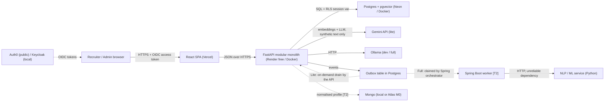
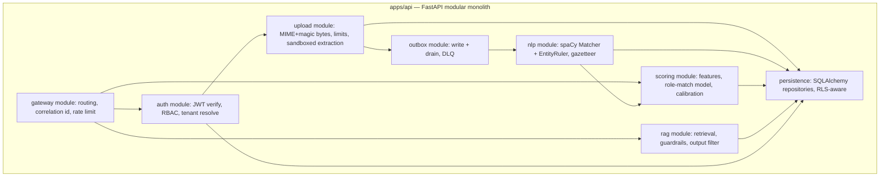

# ARCHITECTURE — Vetharbor

| | |
| --- | --- |
| **Purpose** | Enforces folder structure and system design. The map an agent must not draw outside of. |
| **Primary reader** | AI agent and developer. |
| **Status** | v1.0 — approved for build. Scope lives in `SPEC.md`; schema in `docs/DATA_MODEL.md`. |
| **Owner** | ryan_gabriel_s |
| **Last updated** | 29 Oct 2026 |

**Structural rule.** This file is the single source of truth for boundaries: which modules exist, what they may call, and where the trust edges are. `SPEC.md` defines *what* the system must do; this file defines *where the code goes and what it is allowed to touch*. Do not restate schema here — link to `docs/DATA_MODEL.md`.

Tiers: `[T1]` must ship · `[T2]` should ship · `[T3]` documented only.

---

## 1. System context



Outside the boundary: the OIDC provider, Gemini, Ollama, and the databases. Everything else is one deployable Python service and one static SPA.

## 2. Containers and the three profiles

| Concern | `make dev` (offline) | `make demo-lite` (public) | `make demo-full` (laptop/CI) `[T2]` |
| --- | --- | --- | --- |
| Web | React on Vite, localhost | React on Vercel | same SPA |
| API | FastAPI in Docker | **one** FastAPI service on Render free | FastAPI in kind |
| Identity | Keycloak in Docker | Auth0 free tier | Keycloak |
| Database | Postgres + pgvector in Docker | Neon Postgres + pgvector | Postgres + pgvector |
| Async | API drains the outbox in-request | API drains the outbox on demand | Spring Boot orchestrator consumes |
| LLM | Ollama (3B instruct) | Gemini free tier, synthetic only | Ollama |
| Embeddings | fastembed ONNX, 768 d | Gemini embeddings, `output_dimensionality=768` | sentence-transformers all-mpnet-base-v2, 768 d |
| Document store | not used | not used | Mongo, normalised profiles |
| Network policy | n/a | n/a | kind + Calico, default-deny |

One codebase, one event schema, one `vector(768)` column. Selection happens through a provider registry keyed by `VETHARBOR_PROFILE`; no `if profile ==` conditionals inside business logic.

**Render free rules that shape the design:** 512 MB RAM, 0.1 CPU, 750 h pooled across services, spin-down after 15 min idle, about 60 s to wake, ephemeral disk, no background workers on free. Consequences: exactly one service, no torch, no local files, no keep-alive pings, and an explicit cold-start UI state.

## 3. Component view of the monolith



**Module contract.** Each module owns a router, a service layer and its repositories. A module may import its own repositories and another module's **public service interface**; it may not import another module's ORM models or repositories. `persistence` is the only place that opens a DB connection, and the only place that sets the RLS session variables. The gateway module is a module, not a second service (`ADR-001`).

Dependency direction: `gateway → auth → feature modules → persistence`. No feature module imports the gateway. The ML model is loaded through the scoring module's own interface so `ml/` can run in a separate container in the full profile without changing the API.

## 4. Request and event flow

```mermaid
sequenceDiagram
    participant B as Browser
    participant A as FastAPI
    participant P as Postgres
    participant W as Consumer
    participant L as LLM provider

    B->>A: POST /documents (JWT, multipart)
    A->>A: validate MIME + magic bytes + size + pages
    A->>A: extract text in capped subprocess
    A->>P: BEGIN; INSERT documents; INSERT outbox_events; COMMIT
    A-->>B: 202 accepted, document id, correlation id
    Note over A,P: Lite: drain on demand. Full: Spring worker claims.
    W->>P: SELECT ... FOR UPDATE SKIP LOCKED
    W->>W: nlp entities, embeddings(768), role-match score
    W->>P: idempotency_keys insert (event_id) + results, one tx
    W->>P: mark event done (or attempts+1, 3rd fail -> dead_letter_events)
    B->>A: GET /documents/{id} (poll, aria-live)
    A->>P: RLS-scoped read
    A-->>B: entities + score + evidence snippets
    B->>A: POST /rag/query
    A->>P: tenant-scoped pgvector retrieval
    A->>A: injection classifier + delimiters + canary
    A->>L: prompt, no tools
    A->>A: PII output filter, role-based redaction
    A-->>B: answer + citations or refusal
```

The outbox write is inside the same transaction as the document row. There is no dual write to a queue, therefore no "posted but not stored" state.

## 5. Provider interfaces

```
EmbeddingProvider      embed(texts: list[str]) -> list[list[float]]   # length is always 768
LLMProvider            complete(messages, response_schema) -> Answer  # no tool calls, ever
```

Adapters: `GeminiEmbeddings` (lite), `FastembedONNX` (dev), `SentenceTransformersMPNet` (full); `GeminiLLM` (lite), `OllamaLLM` (dev/full), `FakeLLM` (CI, deterministic fixtures).

`ADR-005` makes the dimension an invariant, not a config value: adapters assert `len(vec) == 768` at construction and the repository rejects a mismatched vector before SQL sees it. Changing the embedding model is a migration (re-embed), not an environment variable. This is what keeps "same schema across profiles" true rather than aspirational.

In CI, `FakeLLM` and `FakeEmbeddings` are the only providers allowed. A guard test asserts that no CI job has Gemini credentials set, so quota cannot be spent and no third party can see test text.

## 6. Queue design and the scale-to-zero rule

- **Default (all profiles): Postgres-native queue.** `outbox_events` + `SELECT … FOR UPDATE SKIP LOCKED`. Keeps the transactional-outbox guarantee, needs no public endpoint, costs $0. `ADR-003`.
- **Drain trigger.** Lite drains on demand: after a write, the API runs one bounded drain pass (N events or T seconds) inside the request's background task, plus an admin-triggered endpoint. There is **no poller**, because a poller prevents Neon scale-to-zero and would exhaust 100 CU-hours (about 400 h at 0.25 CU, roughly 17 days) for no benefit.
- **Idempotency.** `event_id` is the key; `idempotency_keys` has a unique constraint, so redelivery is a no-op.
- **Failure semantics.** `attempts` incremented per claim; on the third failure the row is copied to `dead_letter_events` with a reason and the original is marked `failed`. Admins see the DLQ.
- **Versioning.** Each event carries `version`; consumers accept the current and one prior version.
- **`[T3]` QStash adapter.** Push delivery to a public HTTPS consumer only. Free tier 1,000 messages/day, 1 MB payload, retries may count as deliveries. It is an adapter implementing the same queue interface, never the default.

**Why a laptop consumer plus a push queue cannot work:** QStash delivers over public HTTPS. Your laptop is not publicly reachable. The original plan's topology was impossible, which is why `SKIP LOCKED` is the default.

## 7. Identity, tenancy and zero-trust layering

Applied only where a real trust boundary exists (`ADR-007`).

| Layer | Boundary | Mechanism | Test evidence |
| --- | --- | --- | --- |
| 1. Edge | Browser → API | OIDC access token verified: issuer, audience, expiry, signature. JWKS cached. | wrong-audience, expired and replayed token tests fail closed |
| 2. Tenancy | One tenant's data → another | `org_memberships` maps `sub` → org(s) + role; the API resolves the active tenant server-side and sets `vetharbor.tenant_id`; Postgres RLS filters every tenant table. | F7 cross-tenant read returns zero rows even with a guessed id |
| 3. Service hop `[T2]` | Gateway → worker | OAuth token exchange (RFC 8693) for an audience-bound, minimally scoped, short-lived token. Confirm Keycloak support `[verify]`; otherwise implement in the API. | integration test rejects a token minted for the wrong audience |
| 4. Pods `[T2]` | Pod → pod | default-deny `NetworkPolicy` enforced by Calico or Cilium (kind's default CNI may not enforce `[verify]`), allow-list per service. | a disallowed pod's curl times out — an intentionally failing request, asserted in CI |
| 5. `[T3]` | Worker → API | DPoP sender-constrained tokens with non-extractable WebCrypto keys in the browser; honest ADR that DPoP in a browser does not stop XSS-driven abuse. | design sketch plus ADR, no claim of shipping |

Inside the monolith, inter-module calls are ordinary function calls. There is no token exchange between modules in one process: ceremony without a trust boundary is a flaw, and the ADR says so.

## 8. `[T2]` Spring Boot orchestrator and resilience

`services/orchestrator` claims outbox events and calls the Python NLP/ML service over HTTP — a genuinely unreliable dependency, which is exactly what the patterns are for.

- **Circuit breaker** around the NLP call: failure-rate threshold opens it; half-open probes recover it.
- **Bulkhead** per downstream (NLP, embeddings, LLM) so one slow dependency cannot consume every worker thread.
- **Retry with jittered exponential backoff**, bounded attempts, then hand off to the DLQ path.
- **Time limiter** on every outbound call; the caller decides what a timeout means.
- **Correlation id** propagated in a header end to end; logged on both sides.
- **Chaos test:** `docker compose kill nlp` during a load run; the assertion is that the breaker opens, requests fail fast, and no event is lost — it ends up in the DLQ or stays unclaimed.

Python does not need to own these patterns to prove you understand them; putting them where an unreliable dependency actually exists is the honest design.

## 9. `[T2]` Kubernetes and kind

- `infra/helm` renders: api, web, postgres, keycloak, ollama, orchestrator, plus `NetworkPolicy` objects.
- `make k8s-demo`: create kind cluster → install Calico → `helm install` → run proof tests → `kind delete`.
- Default-deny first, then explicit allows: api→postgres, api→ollama, orchestrator→api-nlp, web→api. Nothing else.
- Plain manifests are the fallback in the cut order; the chart is not load-bearing for the demo.

## 10. Data stores and their justification

| Store | Role | Justification |
| --- | --- | --- |
| Postgres (+pgvector) | System of record: identity mapping, documents, entities, chunks, embeddings, scores, events, audit | One transactional store. `ADR-004`: it is also the vector store, which keeps one consistency model and $0 cost. |
| Mongo `[T2]` | Normalised candidate profile, optional vector experiment | Deliberate document-store course artefact. The ADR either justifies it as a read-model cache or removes it. Never on the write path. |
| Qdrant | Not used | Free clusters suspend after 1 week idle and delete after 4. A demo that silently loses its vector index is worse than no vector index. |
| Filesystem | Not used for storage | Render disk is ephemeral; raw files are never persisted (`ADR-008`). |
| Folder-based docs | Not used | The plan listed it; cut. Two stores already need defending. |

## 11. Frontend architecture

`apps/web`: Vite + React + TypeScript, Tailwind, shadcn/ui. Feature folders, not type folders:

```
src/
  app/            # router, providers, layout
  features/
    auth/         # OIDC login, token refresh, tenant switcher
    documents/    # dropzone, list, detail, status polling
    jobRoles/     # CRUD, admin only
    scoring/      # score card, evidence panel, calibration band
    rag/          # question, citations, refusal state
    admin/        # audit log, model versions, DLQ
  components/     # shared shadcn primitives + project composites
  lib/            # api client (generated types), a11y helpers, format
```

Rules: no fetch in components — every call goes through `lib/api`, which injects the access token and the active tenant, and surfaces a typed error union (`unauthenticated | waking_up | forbidden | not_found | rate_limited | server`). Route guards are per feature folder. Visual and component rules live in `docs/DESIGN.md`; this file only fixes the folder boundaries.

## 12. Deployment and the free-tier budget

| Service | Real limit as checked | Architectural rule |
| --- | --- | --- |
| Vercel Hobby | Personal, non-commercial | Static SPA only. No server functions holding state. |
| Render free | 512 MB / 0.1 CPU, 750 h pooled, idle 15 min, ~60 s wake, ephemeral disk | One service. No torch. No files. Cold-start state in the UI. |
| Neon free | 100 CU-h, 0.5 GB (1 GB reported `[verify]`), scale-to-zero after 5 min | Never poll. Pooled connections. Extracted text only. |
| GitHub Actions | Public repos unlimited; private 2,000 min | Repo is public; no secrets in code; no CI quota spend on external AI. |
| Auth0 free | MAU cap and custom claims `[verify]` | Identity only; roles stay in the database. |
| Gemini free | Volatile quotas; prompts may train products | Synthetic text only; behind an interface; absent from CI. |
| Upstash QStash | 1,000 msg/day, 1 MB | `[T3]` adapter only. |
| Atlas M0 | 512 MB shared | `[T2]` profile store; `[T3]` vector experiment. |
| Keycloak / Ollama / kind | Local only | Needs ~16 GB RAM for the full stack; `make dev` is the low-RAM path. |

Required spend: **$0**. No card for `[T1]` or `[T2]`.

## 13. Observability and correlation

- One JSON log line per request: `ts`, `level`, `correlation_id`, `tenant_id`, `user_sub`, `route`, `status`, `duration_ms`, `event_id` where relevant. Never PII, never document text.
- `correlation_id` is accepted from the client or generated at the gateway, then propagated to consumers, the orchestrator `[T2]`, and LLM call metadata so one upload can be traced end to end in a screenshot.
- The F2 flow's evidence artefact is a log excerpt showing that single id across upload → outbox → consumer → score.

## 14. Repository layout

```
vetharbor/
├── AGENTS.md             # AI behaviour, rules, commands
├── SPEC.md               # scope, flows, requirements
├── docs/
│   ├── ARCHITECTURE.md   # this file
│   ├── DESIGN.md         # visual system and UI rules
│   ├── DATA_MODEL.md     # tables, types, RLS, schemas
│   ├── TESTING.md        # pyramid, gates, CI
│   ├── CONTEXT.md        # progress, decisions, handover
│   ├── course-evidence.md# 19 rows, each linking a commit/test/ADR/screenshot
│   └── runbook.md        # deploy, reset, cold-start, incident notes
├── apps/
│   ├── web/              # React + Vite (Vercel)
│   └── api/              # FastAPI modular monolith (Render)
├── services/
│   └── orchestrator/     # Spring Boot + Resilience4j [T2]
├── ml/                   # spaCy rules, gazetteer, features, training, registry, drift
├── reports/              # Quarto/R statistics [T2]
├── tests-e2e/            # C#: xUnit, RestSharp, Playwright .NET [T2]
├── security/             # STRIDE threat model, injection corpus, AI-SDLC checklist
├── infra/
│   ├── compose/          # docker-compose for dev/full
│   ├── helm/             # chart [T2]
│   └── kind/             # cluster + Calico config, proof tests [T2]
├── scripts/              # generator, seed, drain-once, verify-free-tiers
└── .github/workflows/    # lint → typecheck → unit → integration → security → drift → deploy
```

Root `Makefile` targets: `dev`, `demo-lite`, `demo-full`, `k8s-demo`, `test`, `lint`, `seed`, `drain`, `report`. Agents use these instead of inventing commands.

## 15. ADR register

Kept in this file rather than a directory: at this project size, an ADR that must be opened is an ADR that will not be read. Each entry: status, context, decision, consequences.

| ID | Title | Status |
| --- | --- | --- |
| **ADR-001** | One modular-monolith FastAPI service; gateway is a module | Accepted. Two always-on Render services exhaust the 750 h pool in about 15 days. Consequence: module boundaries must be enforced by tests, not by a process boundary. |
| **ADR-002** | Free-tier limits are first-class design inputs | Accepted. Every component decision cites the quota it spends. Consequence: some designs must be proven locally and recorded, not deployed. |
| **ADR-003** | Postgres-native queue by default; QStash as an optional `[T3]` adapter | Accepted. A push queue cannot reach a laptop consumer. Consequence: drain logic must be bounded and non-polling. |
| **ADR-004** | pgvector is the only vector store; Qdrant dropped | Accepted. Suspended-then-deleted free clusters are a reliability risk. Consequence: index choice and tuning live here, not in a second service. |
| **ADR-005** | Embeddings are 768 dimensions in every profile | Accepted. pgvector columns are fixed-dimension, so mixed providers silently break "same schema". Chosen models: Gemini `output_dimensionality=768`, all-mpnet-base-v2 (768 d), fastembed ONNX of the same model. Consequence: MiniLM-L6-v2 (384 d) is out; changing model is a re-embedding migration. |
| **ADR-006** | Tenancy resolved from `org_memberships`, never from a JWT claim | Accepted. Claims would pin a user to one org and make invites require re-authentication. Consequence: one extra query per request, cached, and the honest story that roles are data, not tokens. |
| **ADR-007** | Zero-trust applied only across real boundaries | Accepted. Token ceremony between modules in one process is theatre. Consequence: an ADR-level statement of what remains unproven, which is more credible than claiming full zero-trust. |
| **ADR-008** | Store extracted text and metadata; never raw files | Accepted. Ephemeral disk and PII minimisation point the same way. Consequence: re-parsing an old document requires the source to be re-uploaded; stated in the runbook. |
| **ADR-009** | IdP-agnostic OIDC: Auth0 public, Keycloak local/dev | Accepted. Keycloak needs about 1 GB RAM and cannot run on Render free. Consequence: only standard claims and JWKS are used, so the swap is configuration; `[verify]` the Auth0 tier. |
| **ADR-010** | Synthetic data only; every score advisory; no automated adverse decision | Accepted. Hiring scoring is high-risk AI use under the EU AI Act and involves personal data under Indonesia's PDP Law. Consequence: the demo cannot show real-world recall on real CVs, and the README says so. |

## 16. `[T3]` appendix — architecture sketches

- **DPoP.** Worker proves key possession per request; API verifies `htm`/`htu` and `jti` replay. A replay store with a TTL is required, which means one more stateful dependency — the honest reason it is `[T3]`.
- **QStash adapter.** Publish from the outbox drain, consume at `POST /events/qstash` with signature verification; per-message attempt counter mirrors the DLQ rules.
- **Atlas vector experiment.** One `$vectorSearch` index on the normalised profile; benchmarked against pgvector recall and latency on the same 200 synthetic documents; result becomes an ADR whichever way it lands.
- **Oracle k3s.** Full profile 24/7; never referenced by a test, a demo link or a CI job. If the VM disappears, nothing breaks.
- **AWS mapping.** API → ECS Fargate or App Runner; queue → SQS with a real worker; vectors → RDS Aurora `pgvector` or OpenSearch; secrets → Secrets Manager; identity → Cognito or a managed IdP; uploads → S3 with a AV-scanning lambda. Table plus a paragraph on what the free-tier design would break: single service, no files, no pollers, no background workers.

## 17. What this architecture deliberately does not do

1. No microservices. One service plus one `[T2]` orchestrator, justified by a real unreliable dependency.
2. No separate API gateway process.
3. No message broker in the default path.
4. No service mesh, no distributed tracing backend.
5. No raw-file storage, no virus-scanning service, no OCR of scanned images (English text-layer documents only, stated as a limitation).
6. No auto-rejection code path anywhere in the repository, including tests.
