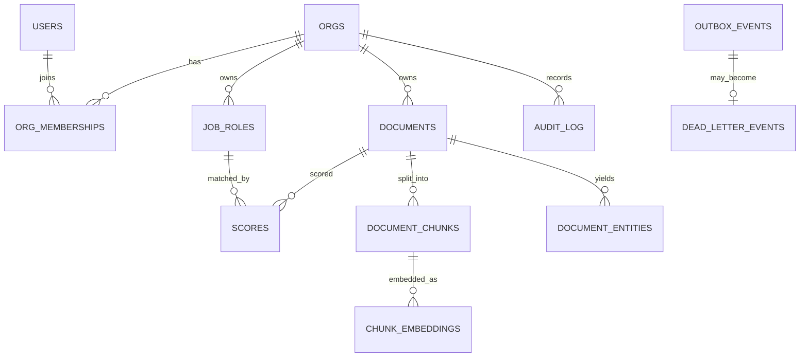

# DATA MODEL — Vetharbor

| | |
| --- | --- |
| **Purpose** | Clarifies database tables, types and schemas. The contract migrations must satisfy. |
| **Primary reader** | AI agent. |
| **Status** | v1.0 — approved for build. No migrations exist yet; this file is the spec they implement. |
| **Owner** | ryan_gabriel_s |
| **Last updated** | 29 Oct 2026 |
| **Authority** | Schema decisions live **here**. `ARCHITECTURE.md` links to this file and does not restate it. |

Tiers: `[T1]` must ship · `[T2]` should ship · `[T3]` documented only.

---

## 1. Principles

1. **Postgres is the system of record.** Documents, entities, chunks, embeddings, scores, events, audit. One consistency model, $0, and pgvector is the only vector store (`ADR-004`).
2. **Every tenant-scoped table carries `org_id uuid not null references orgs`.** RLS is enabled on all of them. A table without `org_id` must have a reason written in this file.
3. **`vector(768)` is an invariant, not a preference** (`ADR-005`). Adapters assert length in Python; a `check` constraint cannot validate vector dimensions, so the repository layer rejects a mismatch before SQL sees it, and a CI test asserts every embedding column in every migration is exactly 768.
4. **No raw files, ever.** `documents` stores extracted text plus a SHA-256 (`ADR-008`).
5. **Synthetic data only** (`ADR-010`). No real personal identifiers exist in this schema's expected contents, and the demo seeds are generated.
6. **UUIDv7 primary keys** for insert locality, `timestamptz` everywhere, `created_at`/`updated_at` on mutable tables, `deleted_at` soft delete only where history matters (`documents`, `job_roles`).
7. **Enums are Postgres enum types, not free text**, so an invalid status fails at the database.
8. **`jsonb` is for payloads and evidence, never for queryable identity.** If a column is filtered or joined, it gets its own typed column.

## 2. Identity and tenancy model



The OIDC provider owns credentials. This database stores only the **subject identifier** from the token, so Auth0 (public) and Keycloak (local) both work without a schema change (`ADR-009`). Roles and tenancy are data, not claims (`ADR-006`).

## 3. Table catalogue

Columns are given as `name type constraints`. Per-table RLS and indexes follow.

### 3.1 `orgs` — tenant root *(no `org_id`: it is the tenant)* `[T1]`

| Column | Definition |
| --- | --- |
| `id` | `uuid pk default gen_random_uuid()` |
| `name` | `text not null unique` — seeded: `Harbor Recruiting`, `Northwind Talent` |
| `slug` | `text not null unique` |
| `is_demo` | `boolean not null default false` — the two seeded tenants are `true` |
| `created_at`, `updated_at` | `timestamptz not null default now()` |

RLS: **not enabled.** Membership is the gate; enabling RLS on the tenant table itself creates a bootstrap problem. Reads are filtered by an explicit `where id in (select org_id from …)` join. This exception is documented here as required by principle 2.

### 3.2 `users` — mirrored OIDC identity `[T1]`

| Column | Definition |
| --- | --- |
| `id` | `uuid pk` |
| `issuer` | `text not null` — e.g. `https://vetharbor.eu.auth0.com/` |
| `subject` | `text not null` — the token `sub` |
| `email` | `citext` — nullable; synthetic demo users may have none |
| `display_name` | `text` |
| `last_login_at` | `timestamptz` |
| `created_at`, `updated_at` | `timestamptz not null default now()` |

Constraints: `unique (issuer, subject)`. **RLS: not enabled** — a user row cannot yet be scoped to an org, and the auth module needs it to *find* the orgs. Access is service-role only; no tenant-facing endpoint returns a raw user row. `email` is stored only for admin-visible member lists and is redacted from every log line.

### 3.3 `org_memberships` — the tenancy spine `[T1]`

| Column | Definition |
| --- | --- |
| `id` | `uuid pk` |
| `org_id` | `uuid not null references orgs on delete cascade` |
| `user_id` | `uuid not null references users on delete cascade` |
| `role` | `user_role not null` — `admin`, `recruiter`, `demo_reader` |
| `status` | `membership_status not null default 'active'` — `invited`, `active`, `revoked` |
| `invited_by` | `uuid null references users` |
| `created_at`, `updated_at`, `revoked_at` | `timestamptz` |

Constraints: `unique (org_id, user_id)`. Index: `(user_id) where status = 'active'` — this is the hot path, resolved once per request and cached in the request context.

### 3.4 `job_roles` — the scoring target `[T1]`

| Column | Definition |
| --- | --- |
| `id` | `uuid pk` |
| `org_id` | `uuid not null references orgs on delete cascade` |
| `title` | `text not null` |
| `description` | `text not null` — the job description text |
| `required_skills` | `text[] not null default '{}'` — gazetteer-normalised |
| `nice_to_have_skills` | `text[] not null default '{}'` |
| `min_years_experience` | `numeric(4,1) not null default 0 check (min_years_experience >= 0)` |
| `embedding` | `vector(768) null` |
| `embedding_model` | `text null` — must name the model that produced `embedding` |
| `status` | `job_role_status not null default 'open'` — `draft`, `open`, `closed` |
| `created_by` | `uuid references users` |
| `created_at`, `updated_at`, `deleted_at` | `timestamptz` |

Constraints: `unique (org_id, lower(title))` for the active set. Check: if `embedding is not null` then `embedding_model is not null`.

A job role is first-class rather than pasted text, so scores are comparable over time, an admin can retire a role, and drift measurement has a stable denominator.

### 3.5 `documents` `[T1]`

| Column | Definition |
| --- | --- |
| `id` | `uuid pk` |
| `org_id` | `uuid not null references orgs on delete cascade` |
| `kind` | `document_kind not null` — `cv`, `proposal`, `paper` |
| `filename` | `text not null` — sanitised, display only |
| `declared_mime` | `text not null` |
| `detected_mime` | `text not null` — magic bytes; a mismatch is a rejection event |
| `sha256` | `char(64) not null` |
| `size_bytes` | `bigint not null check (size_bytes > 0 and size_bytes <= 5242880)` |
| `page_count` | `int check (page_count between 1 and 60)` |
| `extracted_text` | `text not null` |
| `char_count` | `int not null` |
| `word_count` | `int not null` |
| `language` | `text not null default 'en'` |
| `status` | `document_status not null default 'pending'` — `pending`, `processing`, `ready`, `failed`, `rejected` |
| `warning_flags` | `text[] not null default '{}'` — `hidden_text`, `zero_size_font`, `off_page_text`, `possible_injection` |
| `uploaded_by` | `uuid references users` |
| `failure_reason` | `text null` |
| `created_at`, `updated_at`, `deleted_at` | `timestamptz` |

Indexes: `(org_id, status)`, `(org_id, created_at desc)`, `(org_id, sha256)` unique for dedupe within a tenant only — cross-tenant dedupe would leak the existence of another org's document, which is a privacy bug, so uniqueness deliberately includes `org_id`.

`status = 'rejected'` means the upload never passed validation; `'failed'` means processing broke. Both are visible to the recruiter with a reason. Neither is a judgement about a person.

### 3.6 `document_chunks` `[T1]`

| Column | Definition |
| --- | --- |
| `id` | `uuid pk` |
| `document_id` | `uuid not null references documents on delete cascade` |
| `org_id` | `uuid not null` — denormalised deliberately so RLS filters retrieval without a join |
| `ordinal` | `int not null` |
| `text` | `text not null` |
| `token_count` | `int not null` |
| `char_start`, `char_end` | `int not null` — offsets into `documents.extracted_text` |

Constraints: `unique (document_id, ordinal)`. Index: `(org_id)`.

### 3.7 `chunk_embeddings` `[T1]`

Separate table so a re-embed is a replace, not a rewrite of text rows.

| Column | Definition |
| --- | --- |
| `chunk_id` | `uuid pk references document_chunks on delete cascade` |
| `document_id` | `uuid not null references documents on delete cascade` |
| `org_id` | `uuid not null` |
| `embedding` | `vector(768) not null` |
| `embedding_model` | `text not null` |
| `dimensions` | `int not null default 768 check (dimensions = 768)` |
| `created_at` | `timestamptz not null default now()` |

Index: `using hnsw (embedding vector_cosine_ops)` with `m=16, ef_construction=64` — HNSW over IVFFlat because the dataset is small and recall matters more than build time. Index: `(org_id)`. The `dimensions` check is a documented tripwire: the real guard is repository-side, this exists so a hand-written migration fails loudly.

Neon free storage makes HNSW the only sane choice at 200 documents; anything larger and the build is re-considered in a new ADR.

### 3.8 `document_entities` `[T1]`

| Column | Definition |
| --- | --- |
| `id` | `uuid pk` |
| `document_id` | `uuid not null references documents on delete cascade` |
| `org_id` | `uuid not null` |
| `label` | `text not null` — `SKILL`, `ROLE`, `ORG`, `EDU`, `DATE`, `YEARS`, `CONTACT` |
| `text` | `text not null` |
| `normalised` | `text null` — gazetteer canonical form, e.g. `ESCO:351906` |
| `taxonomy` | `text null` — `esco` / `onet` / `local` |
| `confidence` | `numeric(4,3) null` |
| `char_start`, `char_end` | `int not null` |
| `rule_id` | `text null` — which `EntityRuler`/`Matcher` pattern fired |
| `source` | `entity_source not null` — `ner`, `rule`, `regex`, `gazetteer` |
| `is_pii` | `boolean not null default false` |
| `created_at` | `timestamptz` |

Indexes: `(document_id)`, `(org_id, label)`, GIN on `normalised` via `(org_id, label, normalised)`. Offsets are non-negotiable: FR-302's clickable evidence depends on them.

### 3.9 `model_versions` `[T1]`

| Column | Definition |
| --- | --- |
| `id` | `uuid pk` |
| `name` | `text not null` — `role_match` |
| `version` | `text not null` |
| `algorithm` | `text not null` — `logreg`, `gbm` |
| `artifact_path` | `text not null` — file-based registry, e.g. `ml/registry/role_match/v3/` |
| `params` | `jsonb not null default '{}'` |
| `features` | `text[] not null` — the exact feature list at train time |
| `excluded_features` | `text[] not null` — `name`, `gender_proxy`, `age`, `photo`, `institution_prestige` |
| `metrics` | `jsonb not null` — `precision_at_k`, `ndcg`, `calibration`, `psi` |
| `dataset_ref` | `text not null` — generator seed plus version, never a real-data path |
| `model_card_path` | `text not null` |
| `is_active` | `boolean not null default false` |
| `is_shadow` | `boolean not null default false` |
| `trained_at` | `timestamptz not null` |

Constraints: `unique (name, version)`; `unique index on model_versions (name) where is_active` — exactly one active version per model.

### 3.10 `scores` `[T1]`

| Column | Definition |
| --- | --- |
| `id` | `uuid pk` |
| `org_id` | `uuid not null` |
| `document_id` | `uuid not null references documents on delete cascade` |
| `job_role_id` | `uuid not null references job_roles on delete restrict` |
| `model_version_id` | `uuid not null references model_versions` |
| `role_match_score` | `numeric(5,4) not null check (role_match_score >= 0 and role_match_score <= 1)` |
| `band` | `score_band not null` — `strong`, `moderate`, `weak`, `insufficient_evidence` |
| `feature_skill_overlap` | `numeric(5,4) not null` |
| `feature_years_experience` | `numeric(5,4) not null` |
| `feature_embedding_similarity` | `numeric(5,4) not null` |
| `calibration` | `jsonb null` — binned probability versus observed rate |
| `evidence` | `jsonb not null` — array of `{entity, char_start, char_end, why}` |
| `rank_in_query` | `int null` — position when scored as a set |
| `requested_by` | `uuid references users` |
| `created_at` | `timestamptz not null default now()` |

Append-only. No update, no delete: a score is a historical claim about a model's output on a document at a moment. Indexes: `(org_id, job_role_id, role_match_score desc)`, `(document_id, model_version_id)`.

`band` replaces any pass/fail language. `insufficient_evidence` is a real, common outcome and is rendered as a neutral state, never a red one.

### 3.11 `shadow_scores` `[T1]`

Same shape as `scores` plus `compared_to_score_id uuid not null references scores`; never joined into any user-facing query. Its only purpose is the drift delta and the FR-605 audit. Keeping it in a separate table means a shadow row can never leak into a recruiter's view by an accidental join — a bug class worth designing out.

### 3.12 `outbox_events` `[T1]`

| Column | Definition |
| --- | --- |
| `id` | `bigint generated always as identity pk` — ordering |
| `event_id` | `uuid not null unique` — the idempotency key |
| `org_id` | `uuid not null` |
| `aggregate_type` | `text not null` — `document`, `job_role` |
| `aggregate_id` | `uuid not null` |
| `type` | `event_type not null` — `document.uploaded`, `document.re_extract_requested`, `job_role.embed_requested` |
| `version` | `int not null default 1` |
| `payload` | `jsonb not null` |
| `status` | `outbox_status not null default 'pending'` — `pending`, `claimed`, `done`, `failed` |
| `attempts` | `int not null default 0 check (attempts between 0 and 3)` |
| `claimed_at` | `timestamptz null` |
| `claimed_by` | `text null` — consumer identity for forensics |
| `correlation_id` | `text null` |
| `occurred_at` | `timestamptz not null` |
| `completed_at` | `timestamptz null` |

Index: `(status, id)` partial on `status = 'pending'` — the claim path. Claiming uses `FOR UPDATE SKIP LOCKED` ordered by `id`. RLS is **enabled** with an insert policy for the tenant and a select/update policy that additionally allows the service role to cross tenants, because the drain pass is a single privileged consumer. The worker's identity is `claimed_by`, and it is the only role permitted to read `outbox_events` for more than one `org_id`.

### 3.13 `dead_letter_events` `[T1]`

| Column | Definition |
| --- | --- |
| `id` | `uuid pk` |
| `event_id` | `uuid not null unique references outbox_events` |
| `org_id` | `uuid not null` |
| `reason` | `text not null` |
| `last_error` | `text null` — sanitised, no document text |
| `attempts` | `int not null` |
| `payload` | `jsonb not null` — frozen copy |
| `failed_at` | `timestamptz not null` |
| `resolved_at`, `resolved_by` | `timestamptz`, `uuid` |

Admin-visible. Replay = the admin endpoint re-inserts the frozen payload as a **new** `event_id` with `version` unchanged, so the old idempotency record stays intact and replay is provably a no-op for anything already processed (F5).

### 3.14 `idempotency_keys` `[T1]`

| Column | Definition |
| --- | --- |
| `event_id` | `uuid pk references outbox_events on delete cascade` |
| `consumer` | `text not null` |
| `result_status` | `text not null` |
| `result_ref` | `jsonb null` — ids written, for forensics |
| `processed_at` | `timestamptz not null default now()` |

Primary key is `event_id`, so a duplicate delivery hits a unique violation which the consumer catches and converts into a successful no-op.

### 3.15 `rag_queries` `[T1]`

| Column | Definition |
| --- | --- |
| `id` | `uuid pk` |
| `org_id` | `uuid not null` |
| `asked_by` | `uuid references users` |
| `question` | `text not null` |
| `retrieved_chunk_ids` | `uuid[] not null default '{}'` |
| `answer` | `text null` — null on refusal |
| `outcome` | `rag_outcome not null` — `answered`, `refused_no_evidence`, `blocked_injection`, `error` |
| `guardrails` | `jsonb not null` — `{injection_verdict, injection_score, canary_hit, pii_findings, redactions}` |
| `llm_provider` | `text not null` |
| `llm_model` | `text not null` |
| `latency_ms` | `int null` |
| `correlation_id` | `text null` |
| `created_at` | `timestamptz` |

Index: `(org_id, created_at desc)`, GIN on `guardrails jsonb_path_ops`. Answers and citations are audit data: `SPEC.md` F4 must be demonstrable from one row. `question` and `answer` are the only user free text stored, retained for the security eval and deleted on tenant request.

### 3.16 `audit_log` `[T1]`

| Column | Definition |
| --- | --- |
| `id` | `bigint generated always as identity pk` |
| `org_id` | `uuid not null` |
| `actor_user_id` | `uuid null references users` — null for system actions |
| `action` | `text not null` — `auth.login`, `auth.tenant_switch`, `document.upload`, `job_role.create`, `score.request`, `rag.query`, `membership.invite`, `membership.revoke`, `dlq.replay`, `model.activate` |
| `target_type`, `target_id` | `text`, `text null` |
| `result` | `audit_result not null` — `success`, `denied`, `failed` |
| `ip` | `inet null` — hashed at rest via `md5(ip + salt)` in `ip_hash` if retention is a concern `[verify]` hosting rules |
| `correlation_id` | `text null` |
| `metadata` | `jsonb not null default '{}'` |
| `created_at` | `timestamptz not null default now()` |

Append-only, `select` for admins, insert for the service role. Indexes: `(org_id, created_at desc)`, `(org_id, action)`. **Denied** attempts are logged, because the cross-tenant denial is the demo's best evidence and a log that only records successes proves nothing.

### 3.17 `security_eval_runs` `[T1]`

CI-written, admin-read. Makes the guardrail metrics a dataset rather than a build log.

| Column | Definition |
| --- | --- |
| `id` | `uuid pk` |
| `run_at` | `timestamptz not null` |
| `corpus_version` | `text not null` — path to `security/injection-corpus/` revision |
| `corpus_size` | `int not null check (corpus_size >= 50)` |
| `block_rate` | `numeric(5,4) not null check (block_rate >= 0.95)` |
| `false_positive_rate` | `numeric(5,4) not null check (false_positive_rate <= 0.05)` |
| `canary_leaks` | `int not null check (canary_leaks = 0)` |
| `pii_recall` | `numeric(5,4) not null check (pii_recall >= 0.99)` |
| `cross_tenant_chunks` | `int not null check (cross_tenant_chunks = 0)` |
| `provider` | `text not null` — in CI this is `fake` |
| `ci_run_url` | `text null` |

The `check` constraints encode `SPEC.md` §9 thresholds. A CI run cannot write a row that violates a gate, so the gate is enforced twice: once by the test asserting, once by the database refusing the number.

### 3.18 `demo_state` — non-tenant singleton `[T1]`

| Column | Definition |
| --- | --- |
| `id` | `int pk default 1 check (id = 1)` |
| `last_seed_at` | `timestamptz` |
| `seeded_document_count` | `int` |
| `is_readonly_mode` | `boolean not null default true` — the public lite profile is read-only; `make dev` sets it false |
| `updated_at` | `timestamptz` |

No `org_id`: it is one row for the deployment, and the reason is written here per principle 2. `is_readonly_mode` is what makes F1's "upload refused with a pointer to `make dev`" a server-side guarantee rather than a hidden button. The public profile refuses `POST /documents` regardless of what the client sends.

## 4. Row-Level Security

### 4.1 Session variables

Set by the persistence layer at the start of every request, in the same transaction as the work:

```sql
SELECT set_config('vetharbor.tenant_id', $1::text, true);
SELECT set_config('vetharbor.user_id',    $2::text, true);
SELECT set_config('vetharbor.is_admin',   $3::text, true);
```

`true` makes them transaction-local, so a pooled connection cannot leak one tenant's setting into another request. The API never accepts a tenant id from the client body; it is resolved from `org_memberships` (`ADR-006`).

### 4.2 Standard policy

```sql
ALTER TABLE documents ENABLE ROW LEVEL SECURITY;
ALTER TABLE documents FORCE ROW LEVEL SECURITY;

CREATE POLICY documents_tenant_isolation ON documents
  USING (org_id = current_setting('vetharbor.tenant_id', true)::uuid)
  WITH CHECK (org_id = current_setting('vetharbor.tenant_id', true)::uuid);
```

`FORCE` is required: without it the table owner bypasses RLS, which is exactly the mistake that makes an RLS demo fake. Every tenant-scoped table follows this pattern, including the read-only ones, so a developer cannot accidentally cross-broaden a policy by writing an over-permissive `USING` clause.

### 4.3 Roles

| Role | Purpose | Grants |
| --- | --- | --- |
| `vetharbor_app` | Request-path reads/writes | RLS applies; no `BYPASSRLS` |
| `vetharbor_migrate` | DDL | Owner; used only by migrations, never at runtime |
| `vetharbor_worker` | Outbox consumer, cross-tenant | `BYPASSRLS` on `outbox_events`, `dead_letter_events`, `idempotency_keys` only, and it is the role that sets `claimed_by` |

`FORCE ROW LEVEL SECURITY` means even the owner obeys policies, so a misconfigured connection string shows up as empty results in tests rather than silent data exposure in production.

### 4.4 Proof obligations

1. Test F7: session in tenant A, request a document id owned by B → `not_found`, and a direct SQL assertion returns **zero rows**.
2. Test: `set_config` to a UUID the actor is not a member of → RLS yields zero rows; the API never lets the client set it.
3. Test: cross-tenant pgvector retrieval returns zero chunks from the other org.
4. Test: two concurrent `SKIP LOCKED` claims never return the same row.
5. Test: pooled connection reuse does not carry `vetharbor.tenant_id` between requests — transaction-local semantics asserted under a pool of size 1.

## 5. Vector search rules

- Query text is embedded with the **same** provider and model as ingestion; `provider_for(text) -> 768` is a single code path.
- Retrieval is a lateral join filtered by RLS first, then `order by embedding <=> $1::vector limit k`. RLS filtering happens in Postgres, before the ANN scan completes, so another tenant's chunks can never enter the candidate set.
- `ef_search` set per request class (32 for Q&A, 64 for scoring); never globally, because 0.1 CPU punishes a large default.
- Re-embedding is a migration: new `embedding_model` rows written in a batch, then swap, then delete old. `chunk_embeddings.embedding_model` exists so a half-finished migration is visible rather than catastrophic.
- `job_roles.embedding` is produced by the same 768-d adapter, which is why ADR-005 is not optional.

## 6. Enum types

```sql
CREATE TYPE user_role         AS ENUM ('admin','recruiter','demo_reader');
CREATE TYPE membership_status AS ENUM ('invited','active','revoked');
CREATE TYPE document_kind     AS ENUM ('cv','proposal','paper');
CREATE TYPE document_status   AS ENUM ('pending','processing','ready','failed','rejected');
CREATE TYPE entity_source     AS ENUM ('ner','rule','regex','gazetteer');
CREATE TYPE job_role_status   AS ENUM ('draft','open','closed');
CREATE TYPE score_band        AS ENUM ('strong','moderate','weak','insufficient_evidence');
CREATE TYPE event_type        AS ENUM ('document.uploaded','document.re_extract_requested','job_role.embed_requested');
CREATE TYPE outbox_status     AS ENUM ('pending','claimed','done','failed');
CREATE TYPE rag_outcome       AS ENUM ('answered','refused_no_evidence','blocked_injection','error');
CREATE TYPE audit_result      AS ENUM ('success','denied','failed');
```

Enum migration rule: add values in a forward migration before any code uses them; never rename or reuse a value. The alternative (a lookup table with a foreign key) is heavier than the stability risk justifies here.

## 7. Seed data contract

`scripts/seed` is the only thing that writes to the public demo database, and it is deterministic.

| Seed | Value |
| --- | --- |
| Tenants | `Harbor Recruiting` (demo), `Northwind Talent` (demo) |
| Users | 1 admin, 2 recruiters per tenant, 1 `demo_reader` |
| Documents | 200 synthetic CVs from `scripts/generate_synthetic_corpus.py` (faker + templates), roughly 120 / 80 across the two tenants |
| Job roles | 6, two per tenant, including one deliberately unrelated role to produce `weak` and `insufficient_evidence` bands |
| Entities | produced by the spaCy pipeline during seeding, not hard-coded |
| Injection corpus | 50+ attack documents from `security/injection-corpus/` |
| Ground truth | generator records the injected skills and the intended matching role per document, giving labelled relevant/irrelevant pairs for precision@k and NDCG |

Cross-tenant overlap rule: at least one document title exists in both tenants with different bodies, so the F7 test proves isolation rather than proving absence.

**Never seeded:** real names of real people, real contact data, real employer names, real institution names. The generator uses a banned-word list checked in CI so a future edit cannot quietly introduce one.

## 8. `[T2]` Mongo — normalised candidate profile

Justification and removal criteria live in the same ADR as the decision: a second store is only defensible as a **read model**, never as a source of truth.

```
collection: candidate_profiles
{
  _id:               uuid,          // same as documents.id
  org_id:            uuid,          // indexed, and mirrored in every query filter
  document_sha256:   string,
  profile: {
    name_placeholder: "CANDIDATE-A17",   // synthetic label only
    roles:      [{ title, org, years_from, years_to }],
    education:  [{ credential, field, year }],
    skills:     [{ normalised, label, confidence, taxonomy }],
    publications: [{ title, year, venue }],
    timeline:   [{ start, end, kind, ref }]
  },
  completeness: { skills: 0..1, experience: 0..1, education: 0..1 },
  derived_at:     date,
  source_version: int
}
```

Write path: the consumer upserts this after entity extraction, keyed on `_id`, so it is idempotent. Read path: the profile tab. Loss of Mongo must degrade the UI to "profile unavailable" while the Postgres-derived view still works — asserted by a test that stops the container. If that degradation test fails, the store is removed rather than defended.

**`[T3]` Atlas vector experiment:** one `$vectorSearch` index on `profile.skills.embedding`, same 768 dimensions, compared against pgvector on recall, latency and operational cost on the identical 200 documents. Outcome becomes an ADR whichever way it lands. M0 is 512 MB shared and vector-search availability at that tier is `[verify]` in the console.

## 9. Migrations and tooling

- Alembic, one revision per logical change, `up` only — the project is small enough that a broken `down` is cheaper to fix forward than to test twice.
- Naming convention enforced in review: `NNNN_description.py`, e.g. `0007_scores_append_only.py`.
- Every migration that touches a vector column must be covered by the CI dimension-invariant test.
- Local: `make seed` / `make db-reset`. Neon: migrations run from a developer machine or CI with a scoped credential, never from the Render service on boot.
- A schema snapshot `docs/schema.sql` is generated in CI and diffed, so a change to an RLS policy or a constraint is visible in the pull request rather than buried in a revision file.

## 10. `[T3]` appendix — designed but not built

- **Partitioning:** `audit_log` by month and `scores` by `created_at` range if volume ever justifies it. Neon free storage makes this moot today; documented so the future step is obvious.
- **Retention:** per-tenant deletion job plus `rag_queries.question` expiry. Synthetic-only data makes this a design exercise, not an obligation.
- **Encryption at rest and field-level crypto for `users.email`:** only relevant once real data exists, which `ADR-010` forbids.
- **AWS mapping:** RDS Aurora `pgvector`, OpenSearch for vectors, DynamoDB for the profile read model instead of Mongo, S3 for objects the free-tier design deliberately does not have.

## 11. Data-level acceptance checklist

For a reviewer, each of these is a named test in the CI output, not a claim.

1. Every tenant-scoped table has `org_id`, RLS and `FORCE RLS`.
2. Every embedding column is `vector(768)`.
3. `scores` and `audit_log` are append-only, enforced by revoking `update`/`delete` from `vetharbor_app`.
4. Duplicate `event_id` cannot produce two effects.
5. A dead letter can be replayed and the replay is provably idempotent.
6. Two seeded tenants exist and cross-tenant reads return zero rows.
7. No table holds raw file bytes or raw file paths.
8. `security_eval_runs` cannot accept a row that violates the `SPEC.md` §9 thresholds.
9. The public profile's `demo_state.is_readonly_mode` blocks document writes at the server.
